# HandLink: Sign Language Translator Glove (Final Year Project)

This is our final year project at **Pakistan Navy Engineering College (PNEC), NUST**: a glove
that reads American Sign Language (ASL) hand signs and speaks them out loud. A person who
uses sign language wears the glove, makes a sign, and the glove says the letter through a small
speaker, so they can talk to someone who does not know sign language.

- Our paper, *"A Smart Glove for Sign Language Translation Enabled by Machine Learning
  Algorithms"*, was selected and presented at the **41st IU and IEEEP FYP Seminar 2026**
  (Iqra University, Karachi).
- We were among the **gold medal winners** at the **IEEEP Multi-Topic International
  Symposium 2026** in Karachi.
- The project was sponsored by **WinSource Electronics**.

<p align="center">
  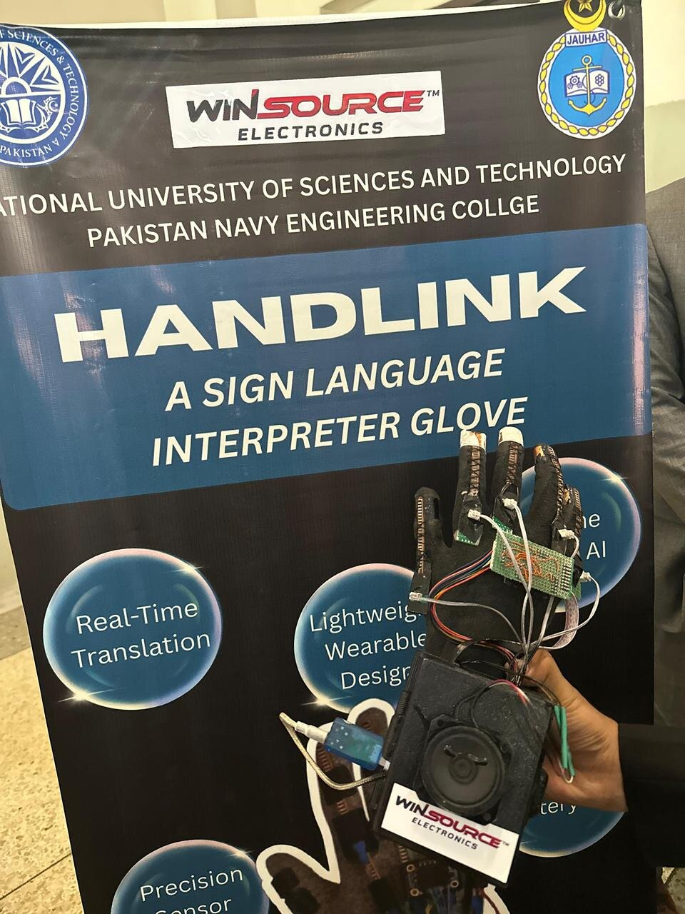<br>
  <em>The glove in front of our project poster.</em>
</p>

## Why a glove

Most sign language translators use a camera and a deep learning model. They work well in a
lab, but they need good lighting, the person has to stay in front of the camera, it needs a
lot of computing power, and some people are not comfortable being filmed all the time. A glove
measures the hand directly (how much each finger is bent, which fingers touch, how the
hand is rotated), so it works anywhere, it doesn't need a camera, and everything can run on a
small computer on the glove itself. Gloves that already exist are expensive and often need the
internet. We wanted one that is cheap enough for people in Pakistan and works offline.

## Hardware

<p align="center">
  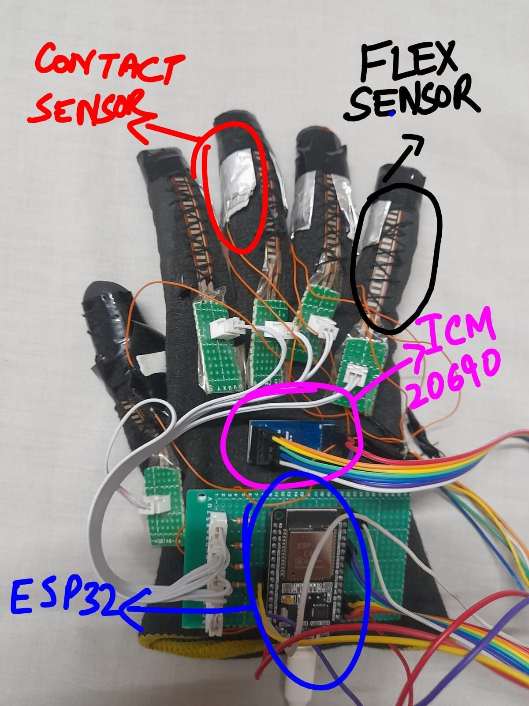<br>
  <em>Where the sensors are on the glove. This photo is from the first version, on an ESP32.</em>
</p>

**ESP32 first, then the Pi Zero 2W:** we did the first data collection and testing with an
**ESP32** on the glove (the photo above). Once the model was trained and working, we moved it
onto the **Raspberry Pi Zero 2W**, so the whole recognition now runs on the glove itself.

| Part | What it does |
|---|---|
| **Raspberry Pi Zero 2W** | Main computer, runs the classifier on the glove itself |
| **5 × 2.2 inch flex sensors** | One on each finger, measures how much the finger is bent |
| **MCP3008** (10-bit ADC, SPI) | The Pi has no analog inputs, so the flex sensors are read through this |
| **ICM-20690** 6-axis IMU | Accelerometer + gyroscope on the back of the hand, very low noise |
| **4 contact sensors** | Index-middle, middle-ring, ring-pinkie and thumb-palm, they tell if those touch |
| **MAX98357A** (I2S amplifier) + speaker | Speaks the recognised sign |

Each flex sensor is wired as a voltage divider with a 39 kΩ resistor, and the MCP3008 reads it.
The contact sensors are conductive pads on the fingers. When two of them touch, they close a
circuit to 3.3 V, so they are read as simple digital inputs on the Pi.

**Why the Pi Zero 2W:** we compared the ESP32, Arduino Mega and Pi Zero 2W. The Pi has 512 MB
RAM and 4 cores, the ESP32 has 520 kB and 2 cores, and the Mega has only 8 kB. The Pi also
runs full Linux, so running the trained model (scikit-learn) on the glove is easy, and it has
Bluetooth built in and an SD card for storage. Its only disadvantage was fewer GPIO pins,
which the ADC solves.

| Schematic | ICM-20690 board |
|---|---|
| 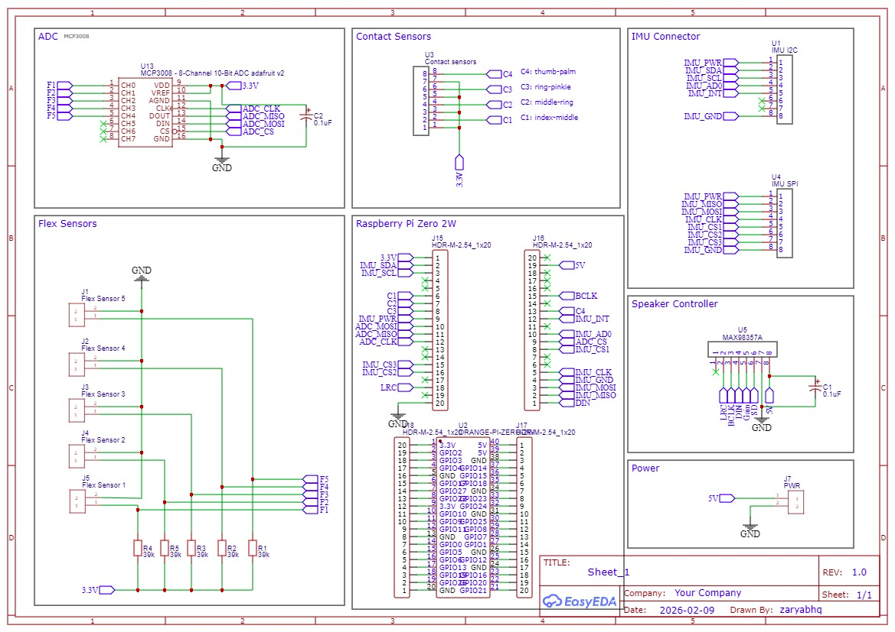 | 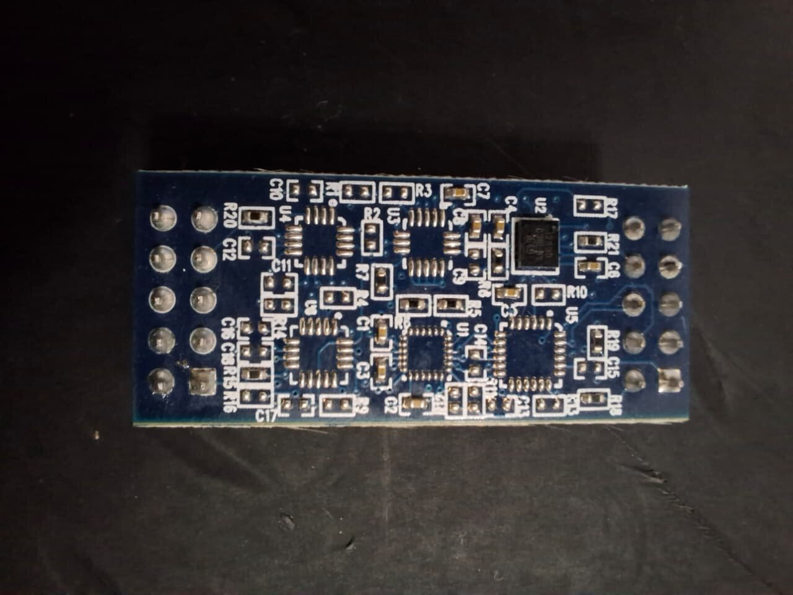 |

<p align="center">
  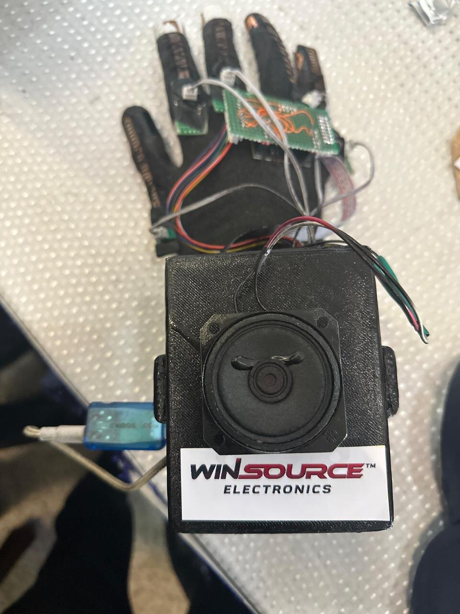<br>
  <em>The glove with the 3D printed box that holds the speaker.</em>
</p>

## How it works

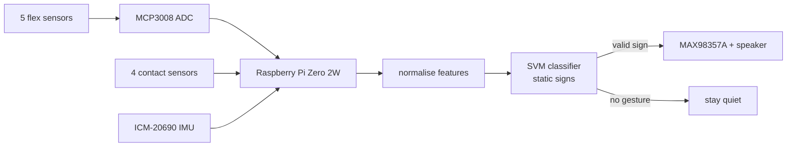

For every reading, the glove makes one feature vector of **15 values**:

```
x = [f1 ... f5,  c1 ... c4,  ax, ay, az,  roll rate, pitch rate, yaw rate]
     flex         contact     accel       gyro
```

Each value is normalised with the mean and standard deviation from the training set
(z-score), so that a flex reading in the hundreds does not drown out a contact sensor that is
just 0 or 1. Then the vector goes to the classifier.

## Our own dataset

There was no glove dataset that matched our sensors, so we made our own. **10 students at our
university volunteered** to wear the glove and record the static ASL signs. Different hand
sizes and different ways of making the same sign is what makes the model work for a new
person and not only for us.

## Static signs: SVM

For static signs (the hand holds one shape), we used a **Support Vector Machine (SVM) with an
RBF kernel**.

<p align="center">
  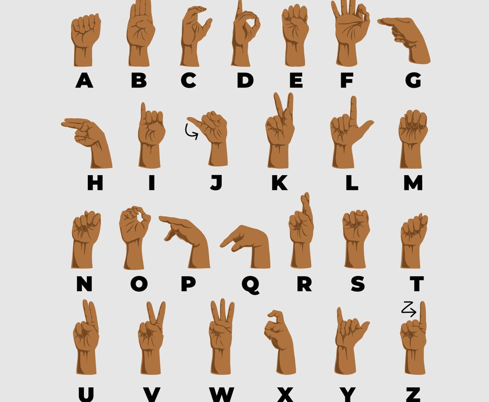<br>
  <em>The ASL alphabet. Most letters are one held hand shape. J and Z are drawn in the air,
  so they are moving signs (see the LSTM part below).</em>
</p>

The main problem in ASL is that many signs look almost the same. **U, V and R** are all
index and middle finger up with the other fingers down; the difference is whether the fingers are
together, apart or crossed. For the sensors, these give very similar numbers, and they can't
be separated by a straight line (a linear boundary) in the raw sensor data.

The RBF kernel solves this. It maps the 15 values into a much higher-dimensional space
without actually computing that space. In that space, signs that were mixed up become
separable. The SVM then puts the boundary with the biggest possible margin between classes.

**Why not logistic regression:** logistic regression only draws linear boundaries. That is
fine for signs that are clearly different, but for U/V/R, A/E or M/N/T the classes overlap
in the raw sensor space, and a linear model mixes them up.

**Why not random forest:** a random forest splits on one sensor value at a time (for example,
"flex 2 > 512"), so its boundaries are made of straight, axis-aligned steps. Similar signs
differ by a small combined change across several sensors, which those steps do not fit
well. A forest also needs a lot of data to generalise properly, and our dataset is from 10
people. It is also a bigger model, because it stores hundreds of trees.

**Why not a neural network for this part:** it would need much more data than we had, and it is
heavier to run on the Pi Zero for something the SVM already does well.

The SVM fits our case: it works well with a small dataset, because the max-margin boundary
generalises well. The trained model only keeps the support vectors, so it is small. Its
prediction is fast and deterministic, which matters on the Pi Zero.

### Contact sensors for signs that look the same

Some signs give almost the same finger bends and hand angle; the only difference is which
fingers touch each other:

- **U, V and R**: the same two fingers up, together (U), apart (V) or crossed (R)
- **A and E**: where the thumb sits against the fingers and palm
- **M, N and T**: all closed fists, the only difference is where the thumb is tucked between the fingers

| U, V and R | M, N and T |
|---|---|
| 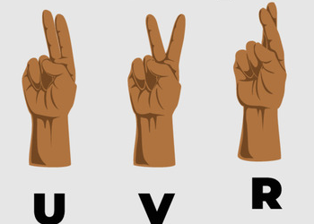 | 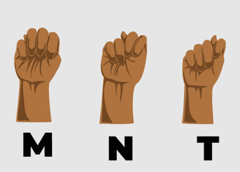 |

Flex sensors and the IMU can't see this difference, so we added the **4 contact sensors**
(index-middle, middle-ring, ring-pinkie, thumb-palm). They give the classifier the extra
information it needs, and these pairs stopped getting mixed up.

### "No gesture" class

A glove that speaks all the time is useless. When the user is not signing, the hand is in
some random position or moving around, and without any check the classifier would still
pick the closest letter and say it. We added a **"no gesture" class**, trained on random hand
positions and on the hand moving continuously. The glove stays quiet for this class
and only speaks when the user makes a valid sign.

### Results

On our test set (1677 samples), the SVM got **98.9% accuracy**, with a macro F1 of 0.99:

| Classification report | Confusion matrix |
|---|---|
| 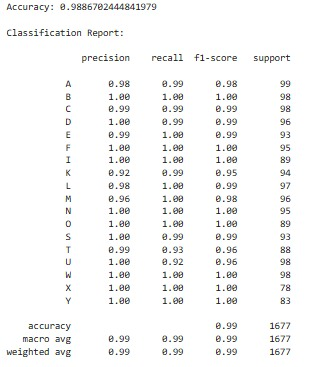 | 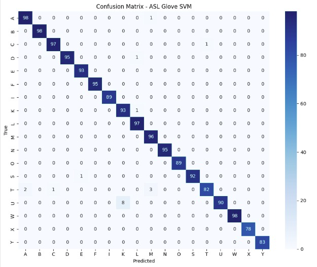 |

The mistakes left are the ones you would expect. **U is sometimes read as K** (8 times),
because K is also index and middle up, and **T is sometimes read as A or M**, because all
three have the thumb near a closed fist. Everything else is almost perfectly on the diagonal.

## Moving signs: LSTM (future work)

Some signs are not one hand shape but a movement (for example, J and Z in the alphabet, and
most word signs). An SVM looks at one moment, so it can't recognise these. For moving signs,
we designed an **LSTM** network. At each time step it takes a 12-value input (5 flex, 4 contact
and the 3 gyro rates), sampled at 60–80 Hz. The LSTM's last hidden state then goes to a softmax
layer that picks the sign.

**Why LSTM and not a 1D CNN:** a 1D CNN only looks at short windows of time, so it learns
local patterns. A moving sign lasts about 90 to 160 frames, and what matters is the whole
movement from start to end. The LSTM keeps a memory through the whole sequence, and its
gates let it decide what to remember and what to forget.

**Why not a normal classifier (SVM or a feedforward network):** these need a fixed-size
input with no notion of order. A moving sign is a sequence, its length changes from person to
person, and the order of the frames is the sign itself. Flattening it into one vector loses
that.

**Why it suits the glove:** one small LSTM layer can handle a whole sequence. It doesn't need a
deep stack of convolution layers, so it stays light enough to run on a phone or a small board.

To train it we needed much more data than we could record ourselves, so **an NGO working
with the deaf community is helping us collect moving-sign data**. The LSTM is part of the
project's **future deliverables**.

## Where it is now

- Working: static ASL signs recognised on the glove itself and spoken through the speaker,
  with the "no gesture" class so it only speaks for real signs.
- In the paper we also described the next stages: a phone app over Bluetooth Low Energy
  for a bigger vocabulary, and an online mode for translation into other languages and
  grammar correction.
- Next: the LSTM for moving signs (data collection with the NGO), and a dataset for
  **Pakistan Sign Language**.

## Awards

| | |
|---|---|
| 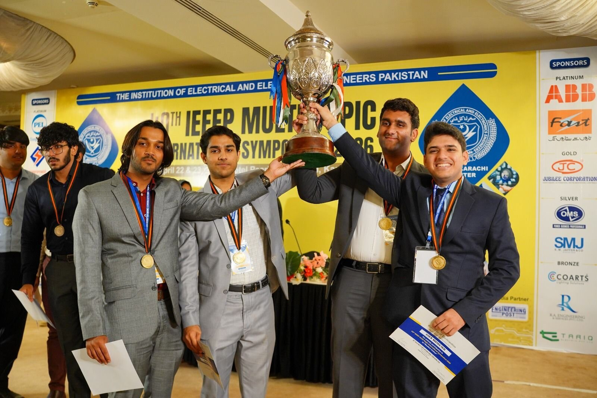 | 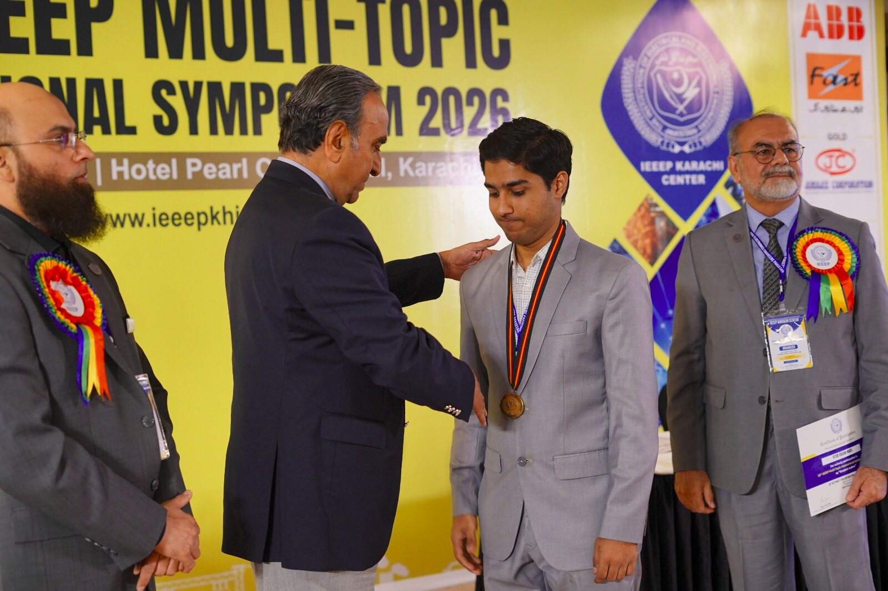 |
| Our team with the trophy at the IEEEP Multi-Topic International Symposium 2026, Karachi | Receiving the gold medal |

## Team

Final year project, Department of Electrical and Power Engineering, PNEC, NUST.

- Muhammad Zaryab Ali Khan
- Syed Faizan Wasti
- Syed Muhammad Mustafa Talal
- Abdul Mannan Khan

Supervisor: **Dr. Syed Sajjad Haider Zaidi**

Thanks to the 10 students who volunteered for the dataset, the NGO helping with the moving
sign data, and **WinSource Electronics** for sponsoring the project.

## Code

The code is not in this repo; this repo is the write-up of the project.
